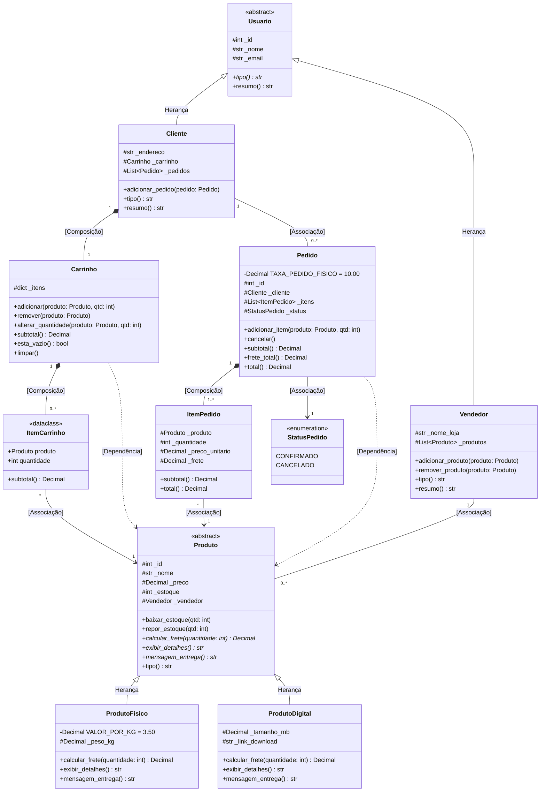

# Marketplace Orientado a Objetos em Python

Sistema de console simulando um marketplace em Python, desenvolvido com foco nos conceitos de Programação Orientada a Objetos (POO), arquitetura em camadas e sem dependências externas além do `pytest`.

O projeto foi estruturado para atender aos requisitos acadêmicos da disciplina, com organização em camadas e modelagem orientada a objetos. Os testes automatizados (pytest) cobrem as principais regras de negócio.

---

## Arquitetura e Estrutura de Pastas

```text
Trabalho_POO/
│
├── main.py                     # Ponto de entrada: injeção de dependências e início da CLI
├── exceptions.py               # Exceções de negócio (EstoqueInsuficienteError, EmailDuplicadoError, etc.)
├── .gitignore                  # Ignora caches (__pycache__, .pytest_cache), ambientes (.venv) e IDEs
│
├── models/                     # Camada de Domínio Puro (sem print, sem input, sem UI)
│   ├── __init__.py
│   ├── usuario.py              # Usuario (ABC), Cliente (compõe Carrinho) e Vendedor (associa Produtos)
│   ├── produto.py              # Produto (ABC), ProdutoFisico e ProdutoDigital (polimorfismo e estoque encapsulado)
│   └── pedido.py               # ItemCarrinho, Carrinho, ItemPedido, Pedido e StatusPedido (Enum)
│
├── repositories/               # Camada de Persistência em Memória (preparada para Nível 3 / SQLite)
│   ├── __init__.py
│   ├── usuario_repository.py   # Persistência e busca de usuários
│   ├── produto_repository.py   # Persistência e busca de produtos por vendedor
│   └── pedido_repository.py    # Histórico e consultas de pedidos por cliente
│
├── services/                   # Camada de Regras de Negócio Puras (sem print / input)
│   ├── __init__.py
│   ├── usuario_service.py      # Gestão de usuários, validação de e-mail único e deleção protegida
│   ├── produto_service.py      # Gestão de catálogo, edição de preço/estoque e filtros
│   ├── pedido_service.py       # Operações de carrinho, checkout com baixa de estoque e cancelamento
│   └── demonstracao_service.py # Carga idempotente de dados de exemplo (sem duplicidades)
│
├── ui/                         # Camada de Apresentação e Interação com o Usuário
│   ├── __init__.py
│   ├── cli.py                  # Menus interativos, captura de fluxos e exibição de dados
│   └── helpers.py              # Formatação de moeda (Decimal), separadores e leituras defensivas
│
├── tests/                      # Testes automatizados (pytest)
│   ├── __init__.py
│   ├── test_abstracao.py       # Impossibilidade de instanciar classes abstratas diretamente
│   ├── test_usuario.py         # Encapsulamento, validações e herança de Usuario
│   ├── test_estoque.py         # Baixa segura, reposição e exceções de saldo insuficiente
│   ├── test_frete.py           # Regras de frete por peso e taxa única fixa por pedido físico
│   ├── test_polimorfismo.py    # calcular_frete, exibir_detalhes e mensagem_entrega
│   ├── test_carrinho.py        # ItemCarrinho dataclass, soma, remoção e subtotais
│   ├── test_pedido.py          # Congelamento histórico de preços e status de cancelamento
│   ├── test_helpers.py         # Formatação de valores monetários
│   └── test_services_fluxo.py  # Integração de ponta a ponta e exclusões protegidas
│
└── docs/                       # Documentação Técnica e Diagramas
    ├── uml.md                  # Especificação UML em Mermaid e tabelas conceituais
    └── uml.png                 # Exportação visual do diagrama de classes em alta resolução
```

---

## Relações de POO

O projeto aplica herança, polimorfismo, composição, associação e dependência.

| Conceito de POO | Onde foi aplicado no código | Arquivo Real |
| :--- | :--- | :--- |
| **1. Herança** | `Usuario` ➔ `Cliente`, `Vendedor`<br>`Produto` ➔ `ProdutoFisico`, `ProdutoDigital` | `models/usuario.py`<br>`models/produto.py` |
| **2. Polimorfismo** | `calcular_frete()`, `exibir_detalhes()` e `mensagem_entrega()` | `models/produto.py` |
| **3. Composição** | `Cliente` ◆➔ `Carrinho`<br>`Pedido` ◆➔ `ItemPedido`<br>`Carrinho` ◆➔ `ItemCarrinho` | `models/usuario.py`<br>`models/pedido.py` |
| **4. Associação** | `Vendedor` ➔ `Produto` (oferta)<br>`Cliente` ➔ `Pedido` (histórico)<br>`ItemPedido` ➔ `Produto` (referência)<br>`ItemCarrinho` ➔ `Produto` | `models/usuario.py`<br>`models/pedido.py` |
| **5. Dependência** | `Pedido.adicionar_item(produto, qtd)`<br>`Carrinho.adicionar(produto, qtd)`<br>`Services` ..> `Models` | `models/pedido.py`<br>`services/*.py` |

---

## Diagrama de Classes UML



> Diagrama em alta resolução também disponível em [`docs/uml.png`](file:///c:/Users/Lucas/OneDrive/Documentos/Trabalho_POO/docs/uml.png) e detalhado em [`docs/uml.md`](file:///c:/Users/Lucas/OneDrive/Documentos/Trabalho_POO/docs/uml.md).

---

## Regra de Negócio: Cálculo de Frete

O frete do pedido é calculado combinando **polimorfismo de produto** e **taxa fixa do pedido**:

1. **Parte Variável por Produto (Polimórfica):**
   - **`ProdutoFisico`**: Cobrado por peso e quantidade: $\text{Frete} = \text{R\$\ 3,50} \times \text{peso\_kg} \times \text{quantidade}$.
   - **`ProdutoDigital`**: Como o envio é eletrônico (download imediato), o frete é sempre **R$ 0,00**.
2. **Taxa Base por Pedido (Cobrança Única):**
   - Se o pedido contiver **pelo menos um** item físico: adiciona-se uma taxa fixa de **R$ 10,00** uma única vez para o pedido inteiro (não por linha de item).
   - Se o pedido for composto **exclusivamente por itens digitais**: a taxa fixa de pedido físico é **R$ 0,00**.
3. **Totalizador do Pedido:**
   $$\text{Frete Total} = \sum (\text{frete de cada item}) + \text{taxa fixa se houver produto físico}$$
   $$\text{Total do Pedido} = \text{Subtotal dos Produtos} + \text{Frete Total}$$

---

## Decisões de Design

1. **Uso de `Decimal` em vez de `float`:**
   - Evita problemas de arredondamento inerentes ao ponto flutuante binário da IEEE 754 (como `0.1 + 0.2 = 0.30000000000000004`).
2. **Classes Abstratas com `ABC` e `@abstractmethod`:**
   - `Usuario` e `Produto` não podem ser instanciadas diretamente, servindo como contratos base para as subclasses concretas. O Python lança `TypeError` caso alguém tente instanciá-las.
3. **Encapsulamento de Atributos e Estoque:**
   - Atributos privados com `@property` evitam atribuições inválidas (como preços negativos ou nomes vazios).
   - A baixa e reposição de estoque acontecem via `baixar_estoque()` e `repor_estoque()` dentro da própria classe `Produto`, mantendo a regra de integridade no objeto responsável.
4. **Desacoplamento em Camadas (Models, Repositories, Services e UI):**
   - Os modelos e serviços não usam `print()` nem `input()`. Lançam exceções de domínio (`EstoqueInsuficienteError`, `EmailDuplicadoError`).
   - A camada de repositórios mantém os dados em memória, mas permite futura substituição por um banco de dados relacional sem alterar as regras de negócio ou os modelos.
