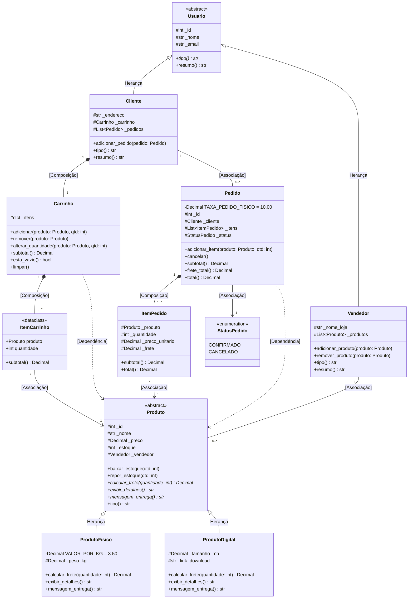

# Marketplace Orientado a Objetos em Python

Sistema de console simulando um **Marketplace completo**, desenvolvido em **Python** com foco estrito nas boas práticas da **Programação Orientada a Objetos (POO)**, arquitetura em camadas desacoplada e sem dependências externas além do `pytest`.

O projeto foi projetado para atender aos requisitos acadêmicos do **Nível 1 (Desk App I)** e estruturado para o **Nível 2 (Desk App II)**, deixando a base pronta para persistência em banco de dados SQLite (**Nível 3**) e interface gráfica (**Nível 4**).

---

## 📁 Arquitetura e Estrutura de Pastas

```text
Trabalho_POO/
│
├── main.py                     # Ponto de entrada: injeção de dependências e início da CLI
├── exceptions.py               # Exceções de negócio (EstoqueInsuficienteError, EmailDuplicadoError, etc.)
├── .gitignore                  # Ignora caches (__pycache__, .pytest_cache), ambientes (.venv) e IDEs
│
├── models/                     # Camada de Domínio Puro (sem print, sem input, sem UI)
│   ├── __init__.py
│   ├── usuario.py              # Usuario (ABC), Cliente (compõe Carrinho) e Vendedor (associa Produtos)
│   ├── produto.py              # Produto (ABC), ProdutoFisico e ProdutoDigital (polimorfismo e estoque encapsulado)
│   └── pedido.py               # ItemCarrinho, Carrinho, ItemPedido, Pedido e StatusPedido (Enum)
│
├── repositories/               # Camada de Persistência em Memória (preparada para Nível 3 / SQLite)
│   ├── __init__.py
│   ├── usuario_repository.py   # Persistência e busca de usuários
│   ├── produto_repository.py   # Persistência e busca de produtos por vendedor
│   └── pedido_repository.py    # Histórico e consultas de pedidos por cliente
│
├── services/                   # Camada de Regras de Negócio Puras (sem print / input)
│   ├── __init__.py
│   ├── usuario_service.py      # Gestão de usuários, validação de e-mail único e deleção protegida
│   ├── produto_service.py      # Gestão de catálogo, edição de preço/estoque e filtros
│   ├── pedido_service.py       # Operações de carrinho, checkout com baixa de estoque e cancelamento
│   └── demonstracao_service.py # Carga idempotente de dados de exemplo (sem duplicidades)
│
├── ui/                         # Camada de Apresentação e Interação com o Usuário
│   ├── __init__.py
│   ├── cli.py                  # Menus interativos, captura de fluxos e exibição de dados
│   └── helpers.py              # Formatação de moeda (Decimal), separadores e leituras defensivas
│
├── tests/                      # Bateria Completa de Testes Automatizados (pytest)
│   ├── __init__.py
│   ├── test_abstracao.py       # Impossibilidade de instanciar classes abstratas diretamente
│   ├── test_usuario.py         # Encapsulamento, validações e herança de Usuario
│   ├── test_estoque.py         # Baixa segura, reposição e exceções de saldo insuficiente
│   ├── test_frete.py           # Regras de frete por peso e taxa única fixa por pedido físico
│   ├── test_polimorfismo.py    # calcular_frete, exibir_detalhes e mensagem_entrega
│   ├── test_carrinho.py        # ItemCarrinho dataclass, soma, remoção e subtotais
│   ├── test_pedido.py          # Congelamento histórico de preços e status de cancelamento
│   ├── test_helpers.py         # Formatação de valores monetários
│   └── test_services_fluxo.py  # Integração de ponta a ponta e exclusões protegidas
│
└── docs/                       # Documentação Técnica e Diagramas
    ├── uml.md                  # Especificação UML em Mermaid e tabelas conceituais
    └── uml.png                 # Exportação visual do diagrama de classes em alta resolução
```

---

## 🧠 Mapeamento das Relações de POO (Para Apresentação)

Todas as 5 relações fundamentais exigidas na disciplina estão aplicadas e evidenciadas no código:

| Conceito de POO | Onde foi aplicado no código | Arquivo Real | Como explicar na apresentação |
| :--- | :--- | :--- | :--- |
| **1. Herança** | `Usuario` ➔ `Cliente`, `Vendedor`<br>`Produto` ➔ `ProdutoFisico`, `ProdutoDigital` | `models/usuario.py`<br>`models/produto.py` | *"As subclasses herdam da classe abstrata base, reaproveitam atributos e validações através do `super().__init__()`, especializando dados como endereço, loja, peso ou link de download."* |
| **2. Polimorfismo** | `calcular_frete()`, `exibir_detalhes()` e `mensagem_entrega()` | `models/produto.py` | *"O método `mensagem_entrega()` e o cálculo de frete são implementados de forma distinta em `ProdutoFisico` e `ProdutoDigital`. A camada superior invoca o método sem checar o tipo com `isinstance`."* |
| **3. Composição** | `Cliente` ◆➔ `Carrinho`<br>`Pedido` ◆➔ `ItemPedido`<br>`Carrinho` ◆➔ `ItemCarrinho` | `models/usuario.py`<br>`models/pedido.py` | *"Relação de todo-parte com ciclo de vida acoplado: o Cliente cria seu próprio Carrinho privativo na instanciação, e o Pedido cria e contém suas próprias instâncias de ItemPedido."* |
| **4. Associação** | `Vendedor` ➔ `Produto` (oferta)<br>`Cliente` ➔ `Pedido` (histórico)<br>`ItemPedido` ➔ `Produto` (referência)<br>`ItemCarrinho` ➔ `Produto` | `models/usuario.py`<br>`models/pedido.py` | *"O `ItemPedido` guarda uma referência direta ao `Produto` associado (`self._produto`). O Vendedor mantém uma lista de produtos da loja, e o Cliente mantém seu histórico de compras."* |
| **5. Dependência** | `Pedido.adicionar_item(produto, qtd)`<br>`Carrinho.adicionar(produto, qtd)`<br>`Services` ..> `Models` | `models/pedido.py`<br>`services/*.py` | *"Relação operacional fraca onde uma classe recebe outra como parâmetro temporário de método para realizar uma ação, sem que o objeto pertença a ela ou tenha ciclo de vida compartilhado."* |

---

## 📊 Diagrama de Classes UML



> Diagrama em alta resolução também disponível em [`docs/uml.png`](file:///c:/Users/Lucas/OneDrive/Documentos/Trabalho_POO/docs/uml.png) e detalhado em [`docs/uml.md`](file:///c:/Users/Lucas/OneDrive/Documentos/Trabalho_POO/docs/uml.md).

---

## 💰 Regra de Negócio: Cálculo de Frete

O frete do pedido é calculado combinando **polimorfismo de produto** e **taxa fixa do pedido**:

1. **Parte Variável por Produto (Polimórfica):**
   - **`ProdutoFisico`**: Cobrado por peso e quantidade: $\text{Frete} = \text{R\$\ 3,50} \times \text{peso\_kg} \times \text{quantidade}$.
   - **`ProdutoDigital`**: Como o envio é eletrônico (download imediato), o frete é sempre **R$ 0,00**.
2. **Taxa Base por Pedido (Cobrança Única):**
   - Se o pedido contiver **pelo menos um** item físico: adiciona-se uma taxa fixa de **R$ 10,00** uma única vez para o pedido inteiro (não por linha de item).
   - Se o pedido for composto **exclusivamente por itens digitais**: a taxa fixa de pedido físico é **R$ 0,00**.
3. **Totalizador do Pedido:**
   $$\text{Frete Total} = \sum (\text{frete de cada item}) + \text{taxa fixa se houver produto físico}$$
   $$\text{Total do Pedido} = \text{Subtotal dos Produtos} + \text{Frete Total}$$

---

## 🚀 Como Executar o Sistema

Requisito: Python 3.10 ou superior.

No terminal, na pasta raiz do projeto:

```bash
python main.py
```

---

## 🧪 Como Rodar os Testes Automatizados

O projeto utiliza `pytest` para cobrir 100% das regras de negócio e conceitos de POO:

```bash
pytest -v
```
*(ou se preferir: `python -m pytest -v`)*

---

## 🎬 Roteiros Sugeridos para os Vídeos de Demonstração

### ⏱️ Roteiro de até 3 Minutos — NÍVEL 1 (Desk App I)
*Objetivo: Apresentar a modelagem conceitual completa de POO, diagrama UML e testes automatizados.*

1. **Abertura (30s):**
   - Apresente seu nome, disciplina e o tema: *Marketplace em Python orientado a objetos*.
   - Abra o arquivo [`docs/uml.md`](file:///c:/Users/Lucas/OneDrive/Documentos/Trabalho_POO/docs/uml.md) ou [`docs/uml.png`](file:///c:/Users/Lucas/OneDrive/Documentos/Trabalho_POO/docs/uml.png) e destaque a modelagem.
2. **As 5 Relações de POO no Código (1m30s):**
   - **Herança e Abstração:** Mostre `Usuario` e `Produto` herdando de `ABC` com `@abstractmethod`. Aponte `Cliente`, `Vendedor`, `ProdutoFisico` e `ProdutoDigital`.
   - **Polimorfismo:** Mostre o método `mensagem_entrega()` e `calcular_frete()` nas duas subclasses, destacando que a camada superior não usa `isinstance`.
   - **Composição:** Mostre `Cliente` instanciando seu `Carrinho` privativo e `Pedido` instanciando seus `ItemPedido`.
   - **Associação:** Mostre `ItemPedido` guardando referência a `self._produto` e `Vendedor` com sua lista de produtos.
   - **Dependência:** Mostre `Pedido.adicionar_item(produto, qtd)` e os métodos do `Carrinho` recebendo `Produto` como parâmetro.
3. **Validação por Testes Automatizados (1m):**
   - Abra o terminal e execute `pytest -v`.
   - Destaque que todos os testes passam (abstração impedindo instanciação direta, baixa e reposição de estoque, cálculo de frete, carrinho e cancelamento de pedidos).

---

### ⏱️ Roteiro de até 6 Minutos — NÍVEL 2 (Desk App II)
*Objetivo: Apresentar o menu interativo completo, todas as operações CRUD em memória e o fluxo de compra e cancelamento de ponta a ponta.*

1. **Abertura e Estrutura (45s):**
   - Apresente o projeto e mostre a divisão arquitetural em `models/` (domínio puro), `services/` (regras sem print/input), `repositories/` (persistência em memória) e `ui/` (console).
2. **Carga Rápida de Demonstração (30s):**
   - Execute `python main.py`.
   - Selecione a opção **[5] Carregar Dados de Demonstração**.
   - Destaque que a carga é **idempotente** (não cria e-mails duplicados se executada novamente).
3. **Gestão de Usuários e Produtos (1m30s):**
   - Menu **[1] Usuários**: liste os usuários mostrando compradores e lojas parceiras. Edite um usuário.
   - Menu **[2] Produtos**: liste o catálogo com dados polimórficos (físicos com peso e digitais com tamanho MB). Mostre a listagem filtrada por vendedor.
4. **Carrinho de Compras e Validações (1m):**
   - Menu **[3] Carrinho**: selecione o cliente Lucas Silva. Adicione um produto físico (Teclado) e um produto digital (E-book).
   - Mostre o subtotal e altere a quantidade para demonstrar a validação de estoque em tempo real.
5. **Finalização de Pedido e Polimorfismo de Entrega (1m15s):**
   - Menu **[4] Pedidos** ➔ **[1] Finalizar Compra**.
   - **Destaque na tela:** O frete por peso do teclado somado à taxa única de R$ 10,00 por ter produto físico, enquanto o e-book teve frete zero.
   - Confirme a compra (`s`).
   - Mostre as instruções polimórficas de entrega emitidas via `mensagem_entrega()` sem uso de `isinstance`.
6. **Cancelamento de Pedido e Reposição de Estoque (1m):**
   - No Menu de Pedidos, selecione **[4] Cancelar Pedido**.
   - Cancele o pedido recém-criado.
   - Volte ao Menu de Produtos e comprove que o estoque dos produtos foi **devolvido e restabelecido**.
   - Encerre na opção **[0] Sair**.

---

## 💡 Decisões de Design para Defender no Vídeo

1. **Uso de `Decimal` em vez de `float`:**
   - Evita problemas de arredondamento inerentes ao ponto flutuante binário da IEEE 754 (como `0.1 + 0.2 = 0.30000000000000004`).
2. **Classes Abstratas com `ABC` e `@abstractmethod`:**
   - `Usuario` e `Produto` nunca podem ser instanciadas no mundo real (não existe um produto "genérico", apenas produtos específicos como físicos ou digitais). O Python lança `TypeError` caso alguém tente instanciá-las.
3. **Encapsulamento de Atributos e Estoque:**
   - Atributos privados com `@property` impedem atribuições inválidas (preços negativos, nomes vazios ou estoques inconsistentes).
   - A baixa e reposição de estoque acontecem via `baixar_estoque()` e `repor_estoque()` dentro da própria classe `Produto`, garantindo que o objeto seja o guardião de suas regras.
4. **Desacoplamento em Camadas (Models, Repositories, Services e UI):**
   - Os modelos e serviços não usam `print()` nem `input()`. Lançam exceções de domínio (`EstoqueInsuficienteError`, `EmailDuplicadoError`).
   - A camada de repositórios mantém os dados em memória neste Nível 2, mas no **Nível 3** bastará trocar a implementação para SQLite sem alterar uma única linha das regras de negócio. No **Nível 4**, a camada `ui/` de console poderá ser substituída por uma interface gráfica (Tkinter, PyQt, etc.) sem impacto no domínio.
