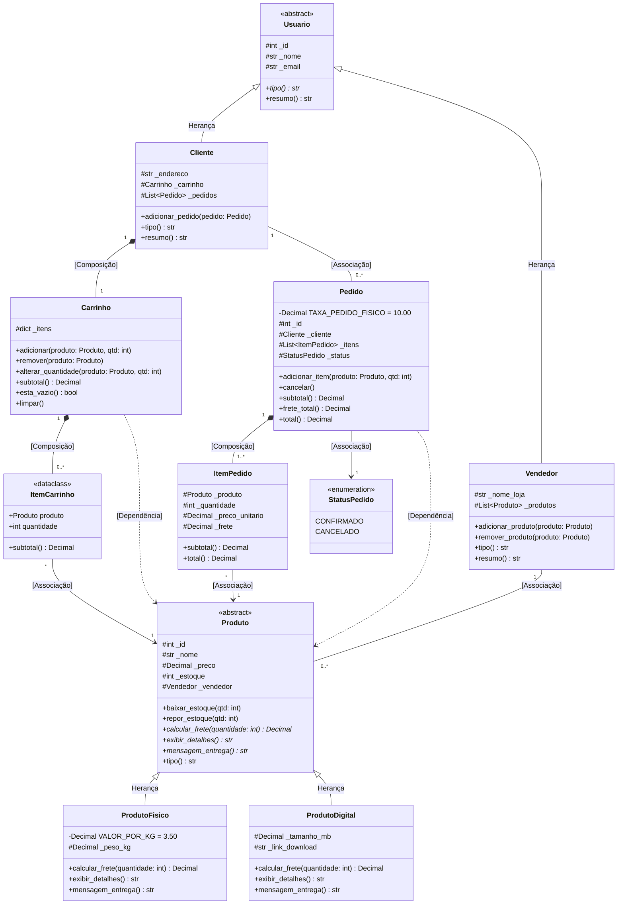

# Marketplace Orientado a Objetos em Python

Sistema de console simulando um marketplace em Python, desenvolvido com foco nos conceitos de Programação Orientada a Objetos (POO), arquitetura em camadas e sem dependências externas além do `pytest`.

O projeto foi estruturado para atender aos requisitos acadêmicos da disciplina, com organização em camadas e modelagem orientada a objetos. Os testes automatizados (pytest) cobrem as principais regras de negócio.

---

## Arquitetura e Estrutura de Pastas

```text
Trabalho_POO/
│
├── main.py                     # Ponto de entrada: injeção de dependências e início da CLI
├── exceptions.py               # Exceções de negócio (EstoqueInsuficienteError, BancoDeDadosError, etc.)
├── .gitignore                  # Ignora caches (__pycache__, .pytest_cache), ambientes (.venv), IDEs e marketplace.db
│
├── database/                   # Camada de Conexão e Esquema Relacional SQLite (Nível 3)
│   ├── __init__.py
│   ├── connection.py           # Gerenciador de conexão SQLite, PRAGMA foreign_keys = ON e transações ACID
│   └── schema.py               # Definição DDL das tabelas (usuarios, produtos, carrinho_itens, pedidos, itens_pedido)
│
├── models/                     # Camada de Domínio Puro (sem print, sem input, sem UI)
│   ├── __init__.py
│   ├── usuario.py              # Usuario (ABC), Cliente (compõe Carrinho) e Vendedor (associa Produtos)
│   ├── produto.py              # Produto (ABC), ProdutoFisico e ProdutoDigital (polimorfismo e estoque encapsulado)
│   └── pedido.py               # ItemCarrinho, Carrinho, ItemPedido, Pedido e StatusPedido (Enum)
│
├── repositories/               # Camada de Persistência Relacional SQLite (Nível 3)
│   ├── __init__.py
│   ├── usuario_repository.py   # Persistência e busca de usuários em SQLite com cache de identidade
│   ├── produto_repository.py   # Persistência e busca de produtos por vendedor em SQLite
│   ├── pedido_repository.py    # Histórico e consultas de pedidos por cliente em SQLite com transações
│   └── carrinho_persistente.py # Sincronização automática do carrinho do cliente com a tabela carrinho_itens
│
├── services/                   # Camada de Regras de Negócio Puras (sem print / input)
│   ├── __init__.py
│   ├── usuario_service.py      # Gestão de usuários, validação de e-mail único e deleção protegida
│   ├── produto_service.py      # Gestão de catálogo, edição de preço/estoque e filtros
│   ├── pedido_service.py       # Operações de carrinho, checkout com baixa de estoque e cancelamento
│   └── demonstracao_service.py # Carga idempotente de dados de exemplo no banco SQLite
│
├── ui/                         # Camada de Apresentação e Interação com o Usuário
│   ├── __init__.py
│   ├── cli.py                  # Menus interativos, captura de fluxos, validação defensiva e exibição
│   └── helpers.py              # Formatação de moeda (Decimal), separadores e leituras defensivas opcionais
│
├── tests/                      # Testes automatizados (pytest)
│   ├── __init__.py
│   ├── conftest.py             # Fixture de isolamento de banco em arquivo temporário (tmp_path)
│   ├── test_abstracao.py       # Impossibilidade de instanciar classes abstratas diretamente
│   ├── test_usuario.py         # Encapsulamento, validações e herança de Usuario
│   ├── test_estoque.py         # Baixa segura, reposição e exceções de saldo insuficiente
│   ├── test_frete.py           # Regras de frete por peso e taxa única fixa por pedido físico
│   ├── test_polimorfismo.py    # calcular_frete, exibir_detalhes e mensagem_entrega
│   ├── test_carrinho.py        # ItemCarrinho dataclass, soma, remoção e subtotais
│   ├── test_pedido.py          # Congelamento histórico de preços e status de cancelamento
│   ├── test_helpers.py         # Formatação de valores monetários e leituras validadas
│   ├── test_services_fluxo.py  # Integração de ponta a ponta e exclusões protegidas
│   ├── test_usuario_repo.py    # CRUD de usuários SQLite e persistência entre conexões
│   ├── test_produto_repo.py    # CRUD de produtos SQLite, precisão Decimal e FK de vendedor
│   └── test_pedido_repo.py     # Transações compostas, rollback por estoque, devolução e carrinho
│
└── docs/                       # Documentação Técnica e Diagramas
    ├── uml.md                  # Especificação UML em Mermaid, tabelas conceituais e diagrama ER
    └── uml.png                 # Exportação visual do diagrama de classes em alta resolução
```

---

## Relações de POO

O projeto aplica herança, polimorfismo, composição, associação e dependência.

| Conceito de POO | Onde foi aplicado no código | Arquivo Real |
| :--- | :--- | :--- |
| **1. Herança** | `Usuario` ➔ `Cliente`, `Vendedor`<br>`Produto` ➔ `ProdutoFisico`, `ProdutoDigital` | `models/usuario.py`<br>`models/produto.py` |
| **2. Polimorfismo** | `calcular_frete()`, `exibir_detalhes()` e `mensagem_entrega()` | `models/produto.py` |
| **3. Composição** | `Cliente` ◆➔ `Carrinho`<br>`Pedido` ◆➔ `ItemPedido`<br>`Carrinho` ◆➔ `ItemCarrinho` | `models/usuario.py`<br>`models/pedido.py` |
| **4. Associação** | `Vendedor` ➔ `Produto` (oferta)<br>`Cliente` ➔ `Pedido` (histórico)<br>`ItemPedido` ➔ `Produto` (referência)<br>`ItemCarrinho` ➔ `Produto` | `models/usuario.py`<br>`models/pedido.py` |
| **5. Dependência** | `Pedido.adicionar_item(produto, qtd)`<br>`Carrinho.adicionar(produto, qtd)`<br>`Services` ..> `Models` | `models/pedido.py`<br>`services/*.py` |

---

## Diagrama de Classes UML



> Diagrama em alta resolução também disponível em [`docs/uml.png`](file:///c:/Users/Lucas/OneDrive/Documentos/Trabalho_POO/docs/uml.png) e detalhado em [`docs/uml.md`](file:///c:/Users/Lucas/OneDrive/Documentos/Trabalho_POO/docs/uml.md).

---

## Regra de Negócio: Cálculo de Frete

O frete do pedido é calculado combinando **polimorfismo de produto** e **taxa fixa do pedido**:

1. **Parte Variável por Produto (Polimórfica):**
   - **`ProdutoFisico`**: Cobrado por peso e quantidade: $\text{Frete} = \text{R\$\ 3,50} \times \text{peso\_kg} \times \text{quantidade}$.
   - **`ProdutoDigital`**: Como o envio é eletrônico (download imediato), o frete é sempre **R$ 0,00**.
2. **Taxa Base por Pedido (Cobrança Única):**
   - Se o pedido contiver **pelo menos um** item físico: adiciona-se uma taxa fixa de **R$ 10,00** uma única vez para o pedido inteiro (não por linha de item).
   - Se o pedido for composto **exclusivamente por itens digitais**: a taxa fixa de pedido físico é **R$ 0,00**.
3. **Totalizador do Pedido:**
   $$\text{Frete Total} = \sum (\text{frete de cada item}) + \text{taxa fixa se houver produto físico}$$
   $$\text{Total do Pedido} = \text{Subtotal dos Produtos} + \text{Frete Total}$$

---

## Decisões de Design

1. **Uso de `Decimal` em vez de `float`:**
   - Evita problemas de arredondamento inerentes ao ponto flutuante binário da IEEE 754 (como `0.1 + 0.2 = 0.30000000000000004`).
2. **Classes Abstratas com `ABC` e `@abstractmethod`:**
   - `Usuario` e `Produto` não podem ser instanciadas diretamente, servindo como contratos base para as subclasses concretas. O Python lança `TypeError` caso alguém tente instanciá-las.
3. **Encapsulamento de Atributos e Estoque:**
   - Atributos privados com `@property` evitam atribuições inválidas (como preços negativos ou nomes vazios).
   - A baixa e reposição de estoque acontecem via `baixar_estoque()` e `repor_estoque()` dentro da própria classe `Produto`, mantendo a regra de integridade no objeto responsável.
4. **Desacoplamento em Camadas (Models, Repositories, Services e UI):**
   - Os modelos e serviços não usam `print()` nem `input()`. Lançam exceções de domínio (`EstoqueInsuficienteError`, `EmailDuplicadoError`, `OperacaoInvalidaError`).
   - A camada de repositórios implementa persistência real em SQLite (`marketplace.db`) mantendo as mesmas assinaturas públicas, desacoplando o banco das regras puras.

---

## Nível 3: Persistência Relacional com SQLite

O sistema opera com persistência relacional completa no arquivo `marketplace.db` na raiz do projeto (gerado automaticamente no primeiro início e ignorado no `.gitignore`).

### Destaques de Implementação:
1. **Sem Dependências Externas nem ORM:** Construído exclusivamente com a biblioteca padrão `sqlite3`.
2. **Queries Parametrizadas:** Toda operação usa parâmetros (`?`), eliminando riscos de SQL Injection.
3. **Chaves Estrangeiras Ativas:** Execução obrigatória de `PRAGMA foreign_keys = ON;` em cada conexão.
4. **Precisão Monetária Sem Float:** Valores monetários são persistidos como `TEXT` formatado em duas casas decimais e convertidos diretamente de/para `Decimal`.
5. **Transações ACID Atômicas:**
   - **Checkout (`finalizar_pedido`):** Gravação do pedido, inserção dos itens com valores congelados e baixa de estoque ocorrem na **mesma transação**. Falhas disparam `ROLLBACK` automático.
   - **Cancelamento (`cancelar_pedido`):** Alteração de status para `Cancelado` e devolução integral do estoque dos produtos ocorrem na **mesma transação**.
6. **Persistência Transparente do Carrinho:** A classe `CarrinhoPersistente` sincroniza adições, alterações de quantidade e remoções diretamente na tabela `carrinho_itens`.
7. **Cache de Identidade (Identity Map):** Garante unicidade de instâncias em memória para a mesma linha do banco relacional, evitando inconsistências de estado.

### Esquema Relacional:
- `usuarios` (`id`, `nome`, `email UNIQUE`, `tipo`, `endereco`, `nome_loja`)
- `produtos` (`id`, `nome`, `preco`, `estoque`, `tipo`, `vendedor_id FK`, `peso_kg`, `tamanho_mb`, `link_download`)
- `carrinho_itens` (`cliente_id FK`, `produto_id FK`, `quantidade`, `PRIMARY KEY (cliente_id, produto_id)`)
- `pedidos` (`id`, `cliente_id FK`, `status`, `data_criacao`)
- `itens_pedido` (`id`, `pedido_id FK`, `produto_id FK`, `quantidade`, `preco_unitario`, `frete`)

---

## Como Executar

### 1. Requisitos:
- Python 3.10 ou superior.
- `pytest` (única dependência de desenvolvimento para os testes).

### 2. Rodando a Aplicação:
```bash
python main.py
```
> O arquivo de banco de dados `marketplace.db` será criado automaticamente se ainda não existir.

### 3. Rodando os Testes Automatizados:
```bash
pytest -v
```
> Todos os 59 testes executam de forma isolada usando instâncias temporárias do SQLite (`tmp_path`), garantindo que os dados de teste não poluam o banco de produção.

---

## Roteiro de Demonstração em Vídeo (Até 6 minutos)

Sugestão de roteiro objetivo para gravação do vídeo de avaliação do Nível 3:

| Minuto | Etapa | Ação no Terminal | O que Explicar |
| :--- | :--- | :--- | :--- |
| **0:00 - 0:45** | **1. Introdução e Arquitetura** | Mostrar estrutura de pastas (`tree` ou VS Code) | Explicar o padrão em camadas (Models puros, Services com regras, Repositories SQLite, UI CLI) e ausência de ORM. |
| **0:45 - 1:30** | **2. Carga Demo e Idempotência** | Iniciar `python main.py`<br>Opção `[5]` (Carga Demo) | Mostrar que a carga populou o banco SQLite. Executar `[5]` novamente para provar **idempotência** (0 produtos novos criados). |
| **1:30 - 2:30** | **3. Gestão e Edição Defensiva** | Opção `[2]` (Produtos) ➔ `[4]` (Editar)<br>Digitar `"abc"` no preço e `"xyz"` no estoque | Mostrar que a entrada inválida é rejeitada com `[!] Entrada inválida` sem crashar com `[ERRO FATAL]`. Pressionar `[Enter]` para manter valor. |
| **2:30 - 3:30** | **4. Carrinho e Compra (Checkout)** | Opção `[3]` ➔ Adicionar ao carrinho (Cliente 3, Produto 1, Qtd 2)<br>Opção `[4]` ➔ Finalizar compra | Mostrar que o pedido foi gerado com **preço congelado**, taxa de frete aplicada e o estoque do produto baixou. |
| **3:30 - 4:15** | **5. Cancelamento de Pedido** | Opção `[4]` ➔ Cancelar pedido `1` | Mostrar que em uma única transação atômica o status virou `Cancelado` e o estoque foi estornado. |
| **4:15 - 5:15** | **6. Comprovação de Persistência** | Encerrar o programa (`[0]`)<br>Reabrir: `python main.py`<br>Opção `[4]` ➔ `[2]` (Listar pedidos) | Provar que ao fechar e reabrir o terminal, o pedido cancelado e todo o histórico permanecem no SQLite (`marketplace.db`). |
| **5:15 - 5:45** | **7. Reiniciar o Banco** | Opção `[6]` (Zerar Banco) ➔ Confirmar com `s` | Demonstrar a funcionalidade de limpeza rápida para reiniciar gravações. |
| **5:45 - 6:00** | **8. Testes Automatizados** | Rodar `pytest -v` no terminal | Mostrar todos os 59 testes passando com sucesso. |
