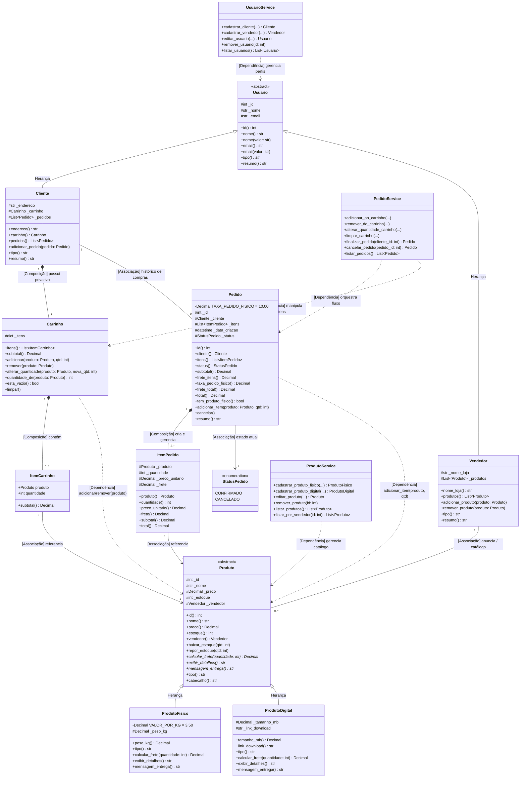

# Diagrama de Classes UML - Marketplace POO

Este documento apresenta a modelagem completa da arquitetura orientada a objetos do Marketplace, cobrindo todas as cinco relações fundamentais exigidas no Nível 1: **Herança**, **Polimorfismo**, **Composição**, **Associação** e **Dependência**.

---

## Diagrama de Classes (Mermaid)

---

## 📖 Legenda das Relações de POO no Projeto

| Conceito | Representação UML | Aplicação Prática no Código | Explicação Conceitual |
| :--- | :---: | :--- | :--- |
| **Herança** | `A <|-- B` | `Usuario <|-- Cliente, Vendedor` `Produto <|-- ProdutoFisico, ProdutoDigital` | As subclasses herdam atributos e comportamentos da classe base abstrata e invocam `super().__init__()`. |
| **Polimorfismo** | Métodos sobrescritos | `calcular_frete()`, `exibir_detalhes()`, `mensagem_entrega()` | Métodos com a mesma assinatura que executam comportamentos distintos dependendo se o produto é Físico ou Digital. Elimina `isinstance`. |
| **Composição** | `A *-- B` | `Cliente *-- Carrinho` `Pedido *-- ItemPedido` `Carrinho *-- ItemCarrinho` | Relação todo-parte forte: `ItemPedido` e `Carrinho` são criados e destruídos junto com a entidade titular. |
| **Associação** | `A -- B` / `A --> B` | `Vendedor -- Produto` `Cliente -- Pedido` `ItemPedido --> Produto` | Vínculo entre duas classes autônomas: o `ItemPedido` guarda referência ao `Produto` associado; o `Vendedor` conhece seus produtos e o `Produto` conhece seu `Vendedor`. |
| **Dependência** | `A ..> B` | `Pedido ..> Produto` `Carrinho ..> Produto` `Services ..> Models` | Relação fraca/operacional: `Pedido.adicionar_item(produto, qtd)` e `Carrinho.adicionar(produto, qtd)` recebem `Produto` como parâmetro sem que o produto pertença a eles. |

---

## 💰 Regra de Cálculo de Frete

1. **Frete Variável por Produto Físico (Polimórfico):**
   - `ProdutoFisico`: `3.50 * peso_kg * quantidade`
   - `ProdutoDigital`: `R$ 0,00`
2. **Taxa Base por Pedido (Cobrança Única):**
   - Se o pedido contiver **pelo menos um** item físico: adiciona taxa única de **R$ 10,00**.
   - Se o pedido for composto **exclusivamente por itens digitais**: taxa adicional é **R$ 0,00**.
3. **Frete Total:**
   $$\text{Frete Total} = \sum (\text{frete dos itens}) + \text{taxa pedido físico}$$
